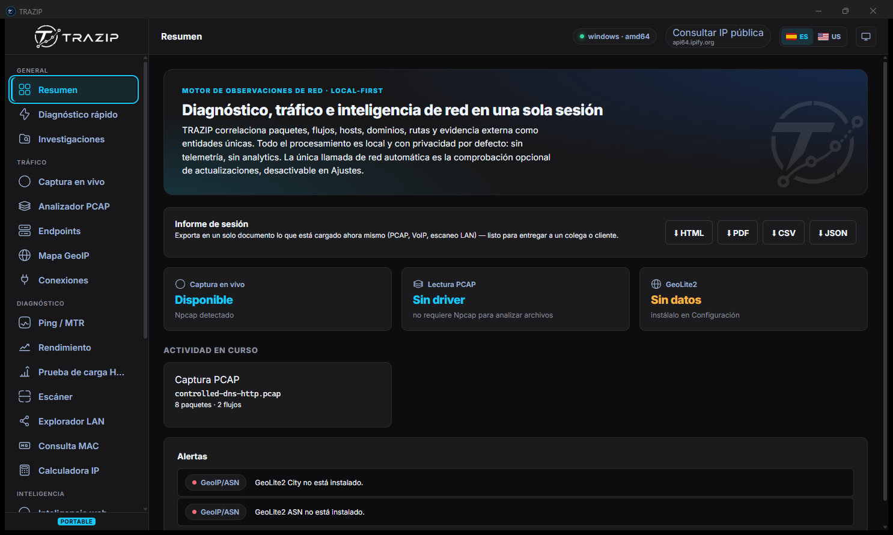
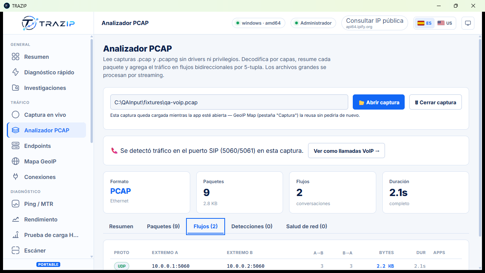
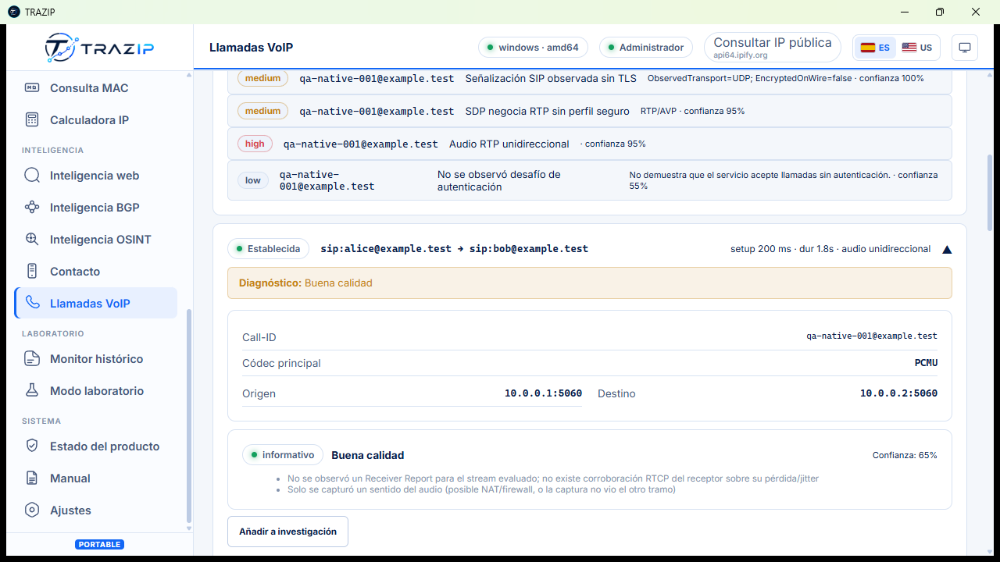
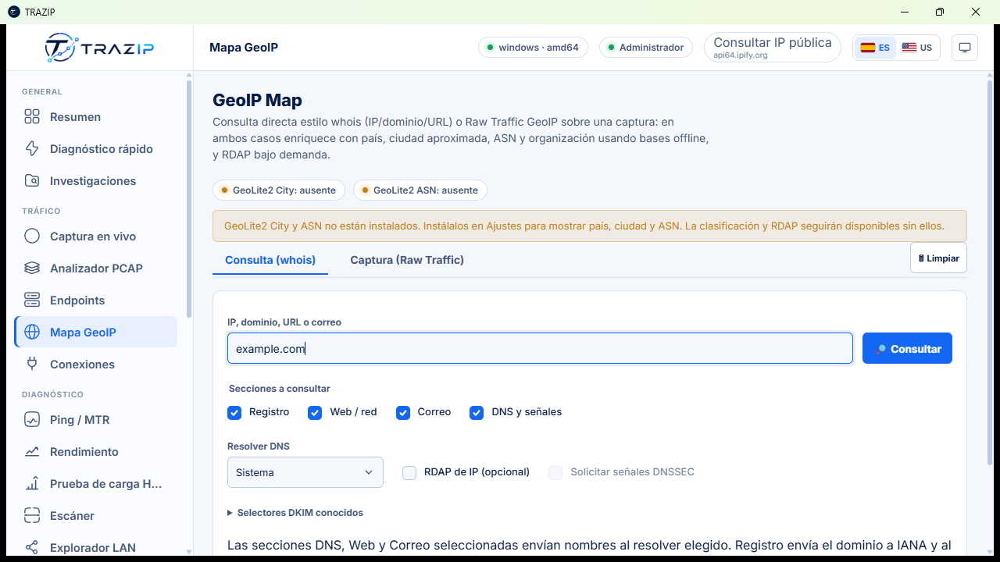

  
  <h1>TRAZIP</h1>
  
<strong>Diagnóstico, observabilidad y análisis defensivo de redes y VoIP desde el escritorio.</strong>

  

    
    
    
    
  

TRAZIP reúne diagnósticos de conectividad, análisis de tráfico e inteligencia de red en una sola sesión. Procesa las capturas localmente y distingue las observaciones de los datos que aportan proveedores externos.

**Estado de distribución.** TRAZIP **v1.0.0 está publicado como release estable para Windows x64**. Descarga la [release oficial](https://github.com/kerwilgil/trazip-network/releases/tag/v1.0.0), el [instalador Setup](https://github.com/kerwilgil/trazip-network/releases/download/v1.0.0/TRAZIP-1.0.0-Setup.exe) o el [ZIP portable](https://github.com/kerwilgil/trazip-network/releases/download/v1.0.0/TRAZIP-1.0.0-portable.zip). Los archivos `.sha256` y el manifiesto de actualización firmado están adjuntos en la release.

**macOS (Apple Silicon, ARM64).** La release v1.0.0 incluye además una distribución inicial para macOS: [`TRAZIP-macos-1.0.0-arm64.zip`](https://github.com/kerwilgil/trazip-network/releases/download/v1.0.0/TRAZIP-macos-1.0.0-arm64.zip) y su [`.sha256`](https://github.com/kerwilgil/trazip-network/releases/download/v1.0.0/TRAZIP-macos-1.0.0-arm64.zip.sha256). Es una compilación **ad-hoc, sin Developer ID ni notarización de Apple**; Gatekeeper exige autorización manual en la primera apertura (instrucciones en el `LEEME.txt` del ZIP).

## TRAZIP en pantalla

<table>
  <tr>
    <td width="50%" align="center"> <strong>Resumen e informe de sesi?n</strong></td>
    <td width="50%" align="center"> <strong>Analizador PCAP ? Flujos</strong></td>
  </tr>
  <tr>
    <td width="50%" align="center"> <strong>Llamadas VoIP ? Detalle de llamada</strong></td>
    <td width="50%" align="center"> <strong>Inteligencia de dominios ? Consulta</strong></td>
  </tr>
</table>

Logo y capturas del proyecto TRAZIP. Las im?genes corresponden a candidatos anteriores de Windows y muestran datos de demostraci?n. La vista de dominios muestra la preparaci?n de la consulta.

## Funcionalidades

| Área | Qué permite hacer |
| --- | --- |
| Diagnóstico de red | Ping, traceroute, MTR, medición de rendimiento, monitores y exploración LAN/Wi-Fi según plataforma y permisos. |
| Tráfico y capturas | Leer PCAP/PCAPNG y analizar flujos, endpoints, DNS, HTTP, TLS/SNI y WebSocket. La captura en vivo requiere permisos y componentes del sistema. La recepción TZSP puede utilizar `tzsp-sender` cuando se incluye en el paquete. |
| Inteligencia IP, MAC y BGP | Clasificar rangos, consultar OUI, ASN, RDAP y RPKI, y examinar rutas y topologías. La topología observada no demuestra relaciones comerciales. |
| Dominios, web y OSINT | Consultar DNS, datos registrales y registros de correo, exportar resultados de dominio en XLSX o CSV comprimido, y explorar certificados, referencias CVE e infraestructura. El reconocimiento activo exige autorización y alcance definido. |
| VoIP y SS7 | Correlacionar SIP, SDP, RTP/RTCP, estimar calidad y reconstruir o exportar audio en formatos compatibles. Analizar SS7 sin conexión con los tipos de enlace y mensajes admitidos. |
| Contactos | Analizar teléfonos y correos localmente, consultar el plan de numeración de Panamá a partir de una copia de ASEP y solicitar reputación externa opcional mediante IPQualityScore. Una asignación histórica no identifica al titular ni al operador actual después de una portabilidad. |
| Investigación y reportes | Reunir sesiones, evidencias y resultados con atribución, contexto y límites para su revisión. |

La señalización SIP sobre TCP está soportada. El análisis pasivo de SIP sobre TLS requiere claves compatibles aportadas por el operador. Sin ellas, TLS se identifica como cifrado. TRAZIP no descifra SRTP.

## Plataformas e instalación

| Plataforma | Estado y requisitos |
| --- | --- |
| Windows | **v1.0.0 estable (x64)** disponible como instalador y ZIP portable. Requiere WebView2. Npcap se instala por separado para captura en vivo. El análisis de archivos PCAP no lo necesita. |
| macOS | **v1.0.0 distribución inicial (solo Apple Silicon ARM64, sin notarizar)**. Probado en macOS 27.2.1. Compilación ad-hoc sin Developer ID: Gatekeeper requiere autorización manual. Verificado: arranque y cierre, interfaz, lectura y análisis de PCAP, VoIP con datos de laboratorio y Ping. **No verificados:** captura en vivo BPF (requiere permisos BPF), MTR, traceroute, WiFi y exportaciones. La interfaz muestra textos de Npcap que no aplican en macOS (limitación conocida). Las actualizaciones se instalan manualmente. No hay build para Intel. |
| Linux | Compilación automatizada verificada. El runtime requiere GTK y WebKitGTK y las operaciones de red dependen de los permisos del sistema. La distribución para usuarios sigue pendiente. |

Los dos paquetes oficiales para Windows son [`TRAZIP-1.0.0-Setup.exe`](https://github.com/kerwilgil/trazip-network/releases/download/v1.0.0/TRAZIP-1.0.0-Setup.exe) y [`TRAZIP-1.0.0-portable.zip`](https://github.com/kerwilgil/trazip-network/releases/download/v1.0.0/TRAZIP-1.0.0-portable.zip). Ambos incluyen `TRAZIP.exe`. No se publica un ejecutable independiente como tercer paquete.

## Privacidad y conexiones externas

- El análisis de capturas se realiza en el equipo. TRAZIP no envía telemetría propia ni sube capturas mediante el actualizador.
- «Consultar IP pública» contacta con ipify solo al pulsar el control. Los diagnósticos activos, las consultas externas y las descargas pueden transmitir los datos necesarios para esa operación y los metadatos normales de conexión.
- Las consultas pasivas usan fuentes externas sin sondear directamente el objetivo. IPQualityScore requiere habilitación, credencial protegida y confirmación de la consulta. Su respuesta no es una prueba de fraude.
- GeoLite2 requiere configuración de MaxMind. Los datasets descargables se gestionan desde Ajustes. En modo instalado se usan directorios por usuario. En portable, la mayoría de los datos operativos queda junto al ejecutable, aunque algunos ajustes protegidos pueden quedar en el perfil o en el almacén seguro.

El actualizador de Windows verifica la firma Ed25519 del manifiesto y los hashes SHA-256 de los binarios. Puede comprobar el canal al iniciar si está habilitado y requiere acciones explícitas para descargar e instalar. En un portable nuevo, la comprobación automática y las notificaciones del monitor empiezan desactivadas. La transición desde 1.4/1.5 a la nueva generación 1.0.0 requiere una instalación manual.

## Arquitectura y desarrollo reciente

El motor Go procesa capturas, protocolos y consultas. La versi?n de compilaci?n del proyecto es Go 1.26.11. Wails comunica ese motor con la interfaz React y TypeScript en español e inglés. Los informes conservan la procedencia y las limitaciones de los resultados.

La rama principal de desarrollo incorpora la inteligencia de dominios y sus exportaciones, avisos cuando falla una exportación y protección frente a la interpretación de valores como fórmulas en las exportaciones CSV de conexiones y endpoints. El instalador limita la desinstalación a los archivos que coloca e incluye los avisos y textos de licencias de terceros. El instalador tiene pruebas automatizadas de sus reglas y se validó el ciclo nativo de instalación, desinstalación y reinstalación en un runner Windows aislado; la verificación del proceso gráfico fue realizada por el usuario.

El canal de distribución reúne la documentación y los archivos aprobados para usuarios. El código fuente se gestiona por separado.
